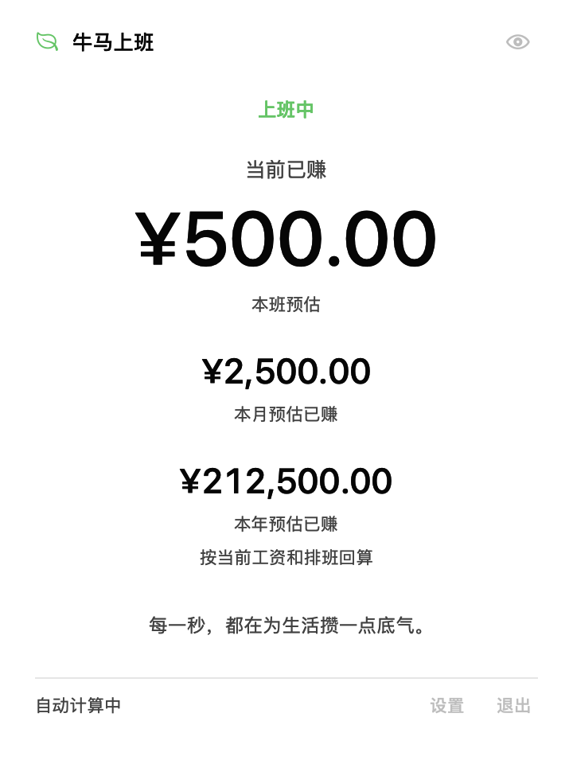
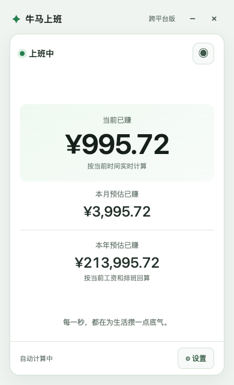

# 本月预估已赚与菜单栏显示验证

日期：2026-11-05；分支：`codex/month-income-menubar`。

## 本次确认的范围

用户最终要求只实施本月预估已赚及菜单栏显示选择。第二期整体延后；此前试做的年度目标、进度、月度汇总、对应配置字段和过程截图已撤回。没有调薪历史或收入账本。

本月金额按当前工资、每周排班和节假日开关回算，从本月一日零点截止当前。跨月班次只把本月实际计薪区间纳入累计；整班金额仍使用班次开始月份的折算基准。月初零点归零，不影响当前跨夜班的金额。

设置与菜单均提供“仅图标／当前班次已赚／本月预估已赚”。选择保存并在重启后恢复；旧版开关开启时迁移为当前班次模式，关闭时迁移为仅图标。休息日当前模式没有金额，本月模式继续显示累计。隐藏金额优先，面板三个金额及设置工资遮蔽，菜单栏恢复图标，恢复金额后仍使用原指标。

## 可执行验证

| 检查 | 实际证据与结果 |
| --- | --- |
| JS 核心 | `npm run test:core` 通过：本月金额、午休保持、下班封顶、修改工资回算、日薪、固定折算、月初、跨月跨年、闰年、节假日、菜单栏指标和隐藏优先级 |
| Swift 集成 | `swift run --disable-automatic-resolution NiumaIntegrationTests`，12 组通过；使用真实临时文件保存重载，包含新选择与旧配置迁移 |
| 两套引擎对照 | `node scripts/test-month-income.mjs`，4 种配置 × 6 个受控时间，共 24 组本月、本年金额误差小于 0.000001；不修改系统时钟 |
| 更新检查回归 | `npm run test:updates`，本地 HTTP 测试验证版本检查与收入集成 |
| 原生收入视图 | 独立 AppKit 窗口加载实际 `IncomeViewController`，受控样例显示当前 ¥500.00、本月 ¥2,500.00、本年 ¥212,500.00；隐藏后三个金额不再包含货币值 |
| 前端操作 | ego-browser 实际操作设置选择、保存、刷新恢复、显示与隐藏；本月金额可见，年度目标和汇总入口已移除 |
| 前端到平台参数 | 浏览器中模拟 Tauri `invoke` / 事件验证三种选择、菜单事件切换、重载及隐藏。仅是桥接参数验证，不代表真实托盘验收 |

## 构建与兼容修复

本次浏览器验证发现第一期 JSON `assert` 导入语法在当前 Chromium 解析失败。已由 `shared/china-holidays.json` 生成普通 ES 模块，并通过 `npm run sync:frontend` 同步 Swift 和前端数据。原生打包脚本携带 `Niuma_NiumaCore.bundle`，避免脱离开发目录后找不到日历资源。长假后的下一班查找不再限于七天，并加入春节长假用例。

原生通用应用构建命令：`bash scripts/build-app.sh`。使用锁定的本地 SwiftPM 依赖及缓存，输出 `build/牛马上班.app`；已成功产出 arm64 + x86_64 通用包，`codesign --verify --deep --strict` 通过；日历 bundle 随包携带。采用临时签名，不代表已公证或正式发布。

## 验证边界

- 原生实际菜单栏右键菜单和系统重启后的系统交互尚未做完整人工验收；当前证据为编译、保存重载、指标选择、AppKit 收入视图及应用包校验。
- 本机没有 Cargo，Tauri 原生构建、macOS Tauri 菜单栏及 Windows 托盘实机行为未验证。Tauri macOS 支持标题金额；Windows 仍以悬停提示和只读菜单显示选中金额。
- 未执行连续八小时运行、真实休眠恢复和完整资源基线；汇总功能已撤回，没有新增月度汇总轮询器。
- 工作区还有其他任务的更新安装与 Windows 宠物改动，本次没有回滚这些内容。整包构建会包含当前工作区的组合状态。

## 界面证据

原生视图，使用受控时间与测试工资：

浏览器视图，使用测试工资与浏览器当时的时钟：

