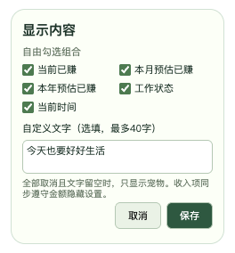

# Windows 桌面宠物验证

日期：2026-11-05。范围：Windows 小牛浮窗实时展示当前班次收入与工作状态；复用原有收入计算、工资设置及隐私规则。

## 实现与验收约定

- Windows 启动时创建 264 × 284 逻辑像素的透明、无边框、置顶窗口，初始放在主屏工作区右下角，不额外显示任务栏图标。
- 小牛支持呼吸、眨眼及休息表情，拖动小牛移动浮窗；点击金额打开原主窗口，关闭动作隐藏浮窗，主面板及托盘提供恢复入口。
- 每秒使用真实时钟重新调用现有 `evaluateIncome`，不维护第二份收入累计数据。共享同源的 `niuma.settings.v1`，工资作息和隐私变化经 storage 事件刷新；隐私开关保存失败不改变已生效显示。
- macOS 不创建宠物窗口，不改变原生 Swift 应用。

## 已执行

使用 ego-browser 在本机临时 HTTP 预览地址打开主面板与宠物两个页面，执行真实表单操作和跨页面 localStorage 同步。所有测试工资均为合成数据，未读取或修改正式应用设置。

| 检查 | 结果 | 证据与边界 |
| --- | --- | --- |
| 首次使用 | PASS | 宠物显示“尚未设置”、金额 —，未生成示例收入 |
| 表单保存到宠物 | PASS | 主面板保存日薪、00:00–23:59 班次后，宠物显示“上班中” |
| 两处金额一致 | PASS | 合成日薪 300 元时，两处同时显示 ¥223.30 |
| 按秒增长 | PASS | 等待宠物金额变化，在 5 秒限时内观察到新金额 |
| 双向隐私 | PASS | 点击宠物隐藏后主面板变为 ••••，主面板恢复后宠物也恢复 |
| 休息与休息日 | PASS | 修改测试配置后，经 storage 事件观察到“休息中”和“休息日” |
| 布局与透明背景 | PASS | DOM 测量内容位于 264 × 284 范围，body 背景为 rgba(0,0,0,0)；已检查截图 |
| 计算与更新回归 | PASS | `npm run test:core`、`npm run test:updates` 通过，包括 Swift 12 组收入集成与更新检查；链接器存在已有搜索路径警告 |
| 脚本、配置和 diff | PASS | 两个前端 JS 的 `node --check`、JSON UTF-8 解析、`git diff --check` 通过 |
| Rust/Windows 构建 | 未通过环境准备 | 本地 Tauri CLI 执行 `build --no-bundle -- --locked --offline` 停于 cargo metadata：找不到 Cargo；未编译本轮 Rust 改动 |
| Windows 10/11 原生窗口 | UNTESTED | 透明合成、置顶、拖动、高 DPI 定位、共享 WebView 存储、托盘恢复、休眠恢复及安装包需 Windows 实机验证 |

透明背景复验：页面 html、body、宠物及小牛容器的背景均为 rgba(0,0,0,0)；原生窗口额外显式设置 RGBA 全零底色。预览改为保留 Alpha 通道的 PNG，像素检查确认四角 Alpha 为 0，保留收入气泡本身的底色。之前的截图未携带 Alpha 通道，显示为白底。Windows 实机透明合成仍待验证。

截图展示合成工资的界面，仅证明浏览器渲染，不证明 Windows 原生窗口行为：

## Windows 复验路径

1. 使用现有锁文件和本地依赖构建 Windows Tauri 应用；缺依赖时再安装对应依赖。
2. 启动应用，确认主屏工作区右下角透明小牛置顶，任务栏无第二个图标，且首次使用无示例收入。
3. 在主窗口保存工资作息，比较两处当前班次收入；等待两秒观察金额，分别切换隐私状态。
4. 拖动小牛跨显示器，检查不同缩放比例；点击金额应打开主面板；点击 × 后从主面板和托盘各恢复一次。
5. 验证午休、休息日、锁屏与休眠恢复后状态及金额，退出应用后宠物一并消失。

本轮未更新版本、提交、发布或覆盖 dist 中的旧安装包。

## 可配置显示内容（2026-11-05）

范围经用户确认：自由组合当前、本月、本年预估收入、工作状态、当前时间及自定义文字；全部取消且文字留空时只显示宠物。通过浮窗齿轮打开设置，最多输入 40 字，自定义文字以纯文本呈现。`niuma.pet.v1` 独立于工资作息，缺失或损坏时恢复默认“当前收入＋工作状态”。本次未增加插件、外部数据源或原生窗口权限。

| 检查 | 结果 | 证据与边界 |
| --- | --- | --- |
| 收入映射及隐私 | PASS | 真实收入核心、固定时间 2026-11-05 10:00、日薪 800 元、09:00–18:00 含一小时午休，当前收入为 ¥100.00，本月为 ¥2,500.00；三种收入统一遮蔽 |
| 旧配置和空选择 | PASS | 默认保留当前收入及状态；空选择＋空文字进入纯宠物模式；仅自定义文字时仍显示气泡 |
| 自由组合、持久化 | PASS | ego-browser 实际勾选全部五项，填写文字、保存、重载；三项收入、状态、时钟和文字均显示，工资表单保存不覆盖独立偏好 |
| 草稿保护 | PASS | 编辑显示内容时，在主窗口保存工资，草稿保持原勾选与文字；点击取消后旧偏好不变 |
| 跨窗口隐私 | PASS | 三种收入一起变为 ••••，主面板同步隐藏；主面板恢复后宠物三个收入项同步恢复 |
| 纯宠物恢复入口 | PASS | 清空选项及文字、保存、重载后气泡隐藏；悬停小牛可打开齿轮设置 |
| 保存失败 | PASS | 浏览器注入针对偏好键的存储失败，保存后显示错误、保留旧偏好与草稿；恢复存储后可重试成功 |
| 自定义文字及实时钟 | PASS | 输入 HTML 标签文本后未创建对应 DOM 元素；取消收入与状态后时钟仍按秒变化 |
| 实际窗口尺寸 | PASS | 将浏览器视口设为 264×284 后测量，设置页保存按钮底部为 257，面板底部为 274；全部内容组合的提示与小牛位于窗口内；已检查以下截图 |
| 核心回归与语法 | PASS | `npm run test:core`、新模块与宠物脚本的 `node --check` 通过；本次修改文件的 diff 检查通过 |
| Windows 原生与安装包 | UNTESTED | 本轮只验证前端与实际计算；原生透明、置顶、拖动、WebView 持久化和重启仍需 Windows 实机验收，未生成新安装包 |

截图均使用本地合成工资，透明背景保留 Alpha：

